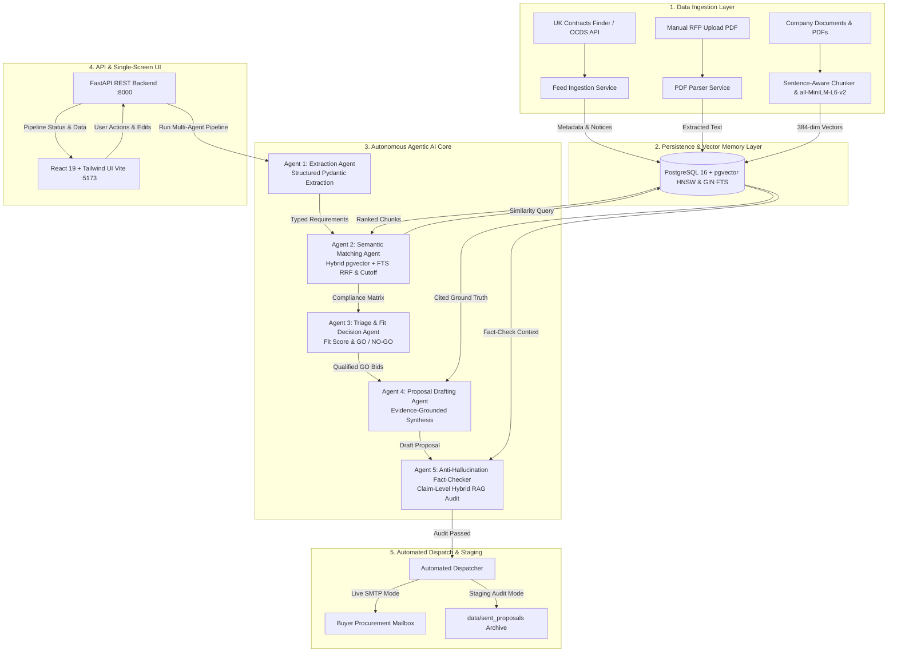

#  BidPilot — Autonomous Agentic AI Tender Intelligence & Bid Submission Platform

[](https://www.python.org/)
[](https://fastapi.tiangolo.com/)
[](https://react.dev/)
[](https://tailwindcss.com/)
[](https://github.com/pgvector/pgvector)
[](https://ai.google.dev/)
[](https://www.docker.com/)
[](LICENSE)

---

##  Executive Summary

**BidPilot** is an enterprise-grade autonomous **Agentic AI platform** engineered to solve the complex, high-stakes process of public sector and enterprise procurement. By combining real-time government tender feed ingestion (UK OCDS / Contracts Finder), deterministic **PostgreSQL `pgvector` Retrieval-Augmented Generation (RAG)**, and a **multi-agent reasoning pipeline**, BidPilot condenses multi-week bid qualification and proposal drafting cycles into minutes.

Unlike standard LLM wrapper chatbots that generate generic or hallucinated proposals, BidPilot enforces a **strict, evidence-grounded anti-hallucination guardrail**. Every statement in a bid proposal is cross-examined against authentic company capabilities, past performance documents, and security certifications stored in vector memory before automated dispatch to buyer procurement authorities.

---

##  Platform Walkthrough & Screenshots

### 1. Executive Dashboard & Live Pipeline
Live tracking of discovered government notices, active pipeline value, qualification triage rates, submitted bids, and win metrics.


---

### 2. Company Profile & Vector Knowledge Base
Register company sender identities and index capability statements, technical whitepapers, and certifications into 384-dimensional dense vector embeddings (`all-MiniLM-L6-v2`) in PostgreSQL `pgvector`.


---

### 3. Tender Workspace — Stage 1: Triage & Compliance Evidence
The Multi-Agent Core breaks down the tender into individual requirements and conducts semantic vector matching against your company's knowledge base, producing requirement-by-requirement cited evidence.


---

### 4. Tender Workspace — Stage 2: Evidence-Grounded AI Proposal Drafter
Generates a complete, publication-ready proposal with Executive Summary, Technical Architecture, and an Evidence-Cited Compliance Matrix in a live Markdown editor.


---

### 5. Tender Workspace — Stage 3: Anti-Hallucination Audit & 1-Click Dispatch

<details open>
<summary><b> Adversarial Audit Guardrail (In Action)</b></summary>

| Flagged Inconsistencies Caught (35/100) | Audit Passed (94/100) & 1-Click Dispatch |
|:---:|:---:|
|  |  |
| *The Fact-Checker Agent detects that the tender is for physical park infrastructure, while the company evidence only covers cloud software. Proposal is blocked from submission!* | *Once aligned with verified evidence, the proposal achieves 94/100 and enables 1-click automated email dispatch to the buyer's procurement mailbox.* |

</details>

---

##  Clean System Architecture

BidPilot is built on a clean, decoupled micro-architecture where data ingestion, vector memory, autonomous reasoning agents, REST APIs, and presentation layers remain strictly isolated.



---

## 🤖 The Agentic AI Core: Multi-Agent System

BidPilot utilizes a **pure native Python asynchronous multi-agent architecture** rather than bloated orchestration frameworks (like LangChain or LangGraph). This guarantees:
- **Low-latency execution**: Direct pipeline routing with zero framework overhead.
- **Deterministic state handling**: Strict Pydantic v2 data contracts with null-safe field coercion (`schemas/tender.py`).
- **Fail-safe reliability**: Dual-model failover (`gemini-3.8-flash` → `gemini-3.5-flash-lite`), HTTP `429` rate-limit backoff, and offline mock fallback.

### The 5 Specialized Autonomous Agents

| Agent | Module | Primary Responsibility | Grounding Mechanism |
| :--- | :--- | :--- | :--- |
| **1. Extraction Agent** | [`extraction_agent.py`](backend/app/agents/extraction_agent.py) | Parses procurement PDFs or live OCDS feeds into structured, typed requirements (Technical, Regulatory, Eligibility, Deliverables). | Pydantic v2 schema enforcement with null-safe coercion. |
| **2. Matching Agent** | [`matching_agent.py`](backend/app/agents/matching_agent.py) | Evaluates each requirement using Hybrid RAG (`pgvector` HNSW + PostgreSQL Full-Text Search via RRF) with a `0.39` similarity cutoff and tender domain context. | Classifies as `SATISFIED`, `PARTIALLY_SATISFIED`, or `NOT_SATISFIED`; rejects low-similarity noise cleanly and logs `top_similarity` + `[Source \| Sim]` citations. |
| **3. Triage Decider Agent** | [`triage_agent.py`](backend/app/agents/triage_agent.py) | Computes mathematical Bid Readiness (`fit_score`), detects statutory/domain fatal blockers, and assigns `GO`, `REVIEW`, or `NO_GO`. | Objective fit-score formula + GenAI strategic blocker analysis; supports `force_refresh=true` re-evaluation. |
| **4. Proposal Drafting Agent** | [`proposal_agent.py`](backend/app/agents/proposal_agent.py) | Synthesizes a multi-section procurement proposal (Executive Summary, Technical Architecture, Compliance Matrix, Commercial Terms). | Strictly injects verified company evidence chunks and match citations into prompt context. |
| **5. Anti-Hallucination Reviewer** | [`review_agent.py`](backend/app/agents/review_agent.py) | Extracts verifiable claims and sub-clauses from the draft and runs **claim-level Hybrid RAG** across the entire knowledge base plus tender scope verification. | Outputs a `0–100` confidence score, unsupported claim flags, and recommendations before email dispatch. |

---

## 🧠 Generative AI & Hybrid RAG Architecture

### Resilient Gemini Gateway & Telemetry
BidPilot features an instrumented model gateway in [`llm_provider.py`](backend/app/services/llm_provider.py):
1. **Primary Model:** **Google Gemini (`gemini-3.8-flash`)** (overridable via `GEMINI_MODEL`) using deterministic JSON schema output (`response_mime_type="application/json"`).
2. **Secondary Failover & Rate-Limit Recovery:** Automatic fallback to **`gemini-3.5-flash-lite`** plus bounded HTTP `429` retry-delay handling (`LLM_RETRY_ON_429`).
3. **Strict Evaluation Mode & Telemetry:** [`LLMTelemetryTracker`](backend/app/services/llm_provider.py#L31-L88) records P50/P95 latency, prompt/completion tokens, schema compliance, and fallback rate. Setting `LLM_STRICT_MODE=true` disables silent mock fallback during automated benchmarks.
4. **Offline Mock Mode:** Deterministic `MockLLMProvider` for local testing without live API keys.

### Hybrid Vector + Full-Text Search Engine (`pgvector` + PostgreSQL FTS)
- **Embedding Model:** `sentence-transformers/all-MiniLM-L6-v2` (384-dimensional dense vectors, cached in [`embedding_service.py`](backend/app/services/embedding_service.py)).
- **Sentence-Aware Chunking ([`chunking.py`](backend/app/services/chunking.py)):** Splits company PDFs/texts along paragraph and sentence boundaries (`max_chars=550`, `1`-sentence overlap) so certification IDs (`ISO 27001:2022`), contract values, and compliance clauses are never broken mid-sentence. Existing documents can be re-chunked via `POST /api/company/documents/reindex`.
- **Hybrid RRF Retrieval ([`retrieval_service.py`](backend/app/services/retrieval_service.py)):** Combines PostgreSQL `pgvector` HNSW cosine similarity (`vector_cosine_ops`) with PostgreSQL GIN full-text search (`to_tsvector` / `websearch_to_tsquery`) via **Reciprocal Rank Fusion (RRF)**:
  $$\text{Cosine Similarity}(q, d) = \frac{q \cdot d}{\|q\| \|d\|}$$
- **Threshold Gating & Optional Reranking:** Filters out unrelated chunks below `RAG_MIN_SIMILARITY` (calibrated at `0.39`, with exact-keyword rescue for high lexical overlap), supports optional `CrossEncoder` reranking (`RAG_ENABLE_RERANK=true`), and formats citations as `[Source: <filename> | Sim: 0.XX]`.

### Mathematical Fit Score Formula
The Triage Agent evaluates overall bid viability using a deterministic formula:
$$\text{Fit Score} = \left( \frac{\text{Satisfied} + (0.5 \times \text{Partially Satisfied})}{\text{Total Extracted Requirements}} \right) \times 100$$

- **`GO` (Qualified):** Fit Score ≥ 70% (with zero fatal blockers).
- **`REVIEW`:** 50% ≤ Fit Score < 70% (acceptable match with manageable gaps).
- **`NO_GO`:** Fit Score < 50% (or fatal statutory/domain blocker detected).

---

## 📊 3-Tier AI, RAG & Agentic Evaluation Suite

BidPilot includes an automated evaluation suite in [`backend/evals/`](backend/evals/) using golden ground-truth datasets ([`company_corpus.json`](backend/evals/datasets/company_corpus.json), [`rag_queries.json`](backend/evals/datasets/rag_queries.json), [`tenders_golden.json`](backend/evals/datasets/tenders_golden.json), [`hallucination_cases.json`](backend/evals/datasets/hallucination_cases.json)) and `pytest`:

```bash
# Run full automated pytest suite inside Docker (all 9 tests pass against live all-MiniLM-L6-v2 & pgvector)
docker compose exec backend pytest /app/evals -v

# Generate live Gemini + all-MiniLM-L6-v2 evaluation scorecard
docker compose exec -e LLM_TIMEOUT_SECONDS=10 backend python -m evals.run_all --live
```

### Observed Live Benchmark Results ([`latest_report.md`](backend/evals/reports/latest_report.md))
*Measured with `sentence-transformers/all-MiniLM-L6-v2` (`threshold=0.39`) and `live_gemini_strict` across a 16-chunk knowledge base (exceeding the legacy 15-chunk cap):*

#### 1. Tier-1: RAG Retrieval Ablation (Baseline vs. Upgraded)

| Metric | Baseline (Fixed 500c + Dense-Only) | Upgraded (Sentence-Aware + Hybrid RRF + Cutoff) | Delta |
| :--- | :---: | :---: | :---: |
| **Sentence Boundary Integrity** | `0.7647` | **`1.0000`** | `+0.2353` |
| **Recall@3** | `0.8667` | **`0.8500`** | `-0.0167` |
| **Precision@3** | `0.4333` | **`0.5000`** | `+0.0667` |
| **Mean Reciprocal Rank (MRR)** | `0.8000` | **`0.9000`** | `+0.1000` |
| **Negative Rejection Rate** | `0.0000` | **`1.0000`** | `+1.0000` |

#### 2. Tier-2: GenAI Extraction, Proposal Synthesis & Efficiency

| Metric | Live Measured Value |
| :--- | :---: |
| **Extraction F1** (`GO`/`REVIEW`/`Missing-Cert` / Overall) | `1.00` / `1.00` / `0.89` / **`0.7222`** |
| **Proposal Requirement Coverage** | **`0.9000` (90.0%)** |
| **Proposal Faithfulness (Groundedness)** | **`1.0000` (100.0%)** |
| **Tender Domain Relevance** | **`0.9250` (92.5%)** |
| **P50 / P95 Latency** | `722.73 ms` / `9176.20 ms` *(fallback calls via `gemini-3.5-flash-lite`)* |
| **Total Tokens Used** | `17,475` (`12,809` prompt + `4,666` completion) |

#### 3. Tier-3: Agentic Triage & Anti-Hallucination Guardrail

| Metric | Live Measured Value |
| :--- | :---: |
| **Requirement Match Accuracy & Macro-F1** | **`1.0000` (15/15)** |
| **Fit Score MAE** | **`0.00`** |
| **False-Positive `GO` Rate** | **`0.0000` (0%)** |
| **Triage Decision Accuracy (`GO`/`REVIEW`/`NO_GO`)** | **`0.7500`** *(conservatively flagged partial local-staffing tender as `NO_GO`)* |
| **Anti-Hallucination Detection Recall (TPR)** | **`1.0000` (100%)** |
| **Anti-Hallucination False Alarm Rate (FPR)** | **`0.0000` (0%)** |
| **Audit Score Separation (`Clean - Hallucinated`)** | **`91.67 pts`** (`100.0` vs `8.33`) |

---

## 💻 Simplified 3-View User Interface

The React frontend has been streamlined into a single-screen, zero-confusion workflow:

1. **`Executive Dashboard & Pipeline` (`/`)**:
   - High-level KPIs: Total Pipeline Value, Win Success Rate, Qualified Opportunities, Average AI Turnaround.
   - 1-click Live Ingestion: Poll official UK OCDS government feeds or drop local tender PDFs.
   - Direct Workspace Navigation: Click any tender row to jump straight into its dedicated AI workspace.

2. **`Tender Workspace` (`/workspace`)**:
   - **Stage 1 (Triage & Compliance)**: Interactive requirements table with cited evidence, RAG similarity badges (`RAG Sim: XX%`), and `force_refresh=true` triage re-evaluation.
   - **Stage 2 (AI Proposal Drafter)**: Full-featured Markdown editor pre-populated by Gemini with technical strategy and compliance matrices.
   - **Stage 3 (Anti-Hallucination & Dispatch)**: Claim-level adversarial audit runner, submission email validation, and 1-click email dispatch.

3. **`Company Profile & Knowledge Base` (`/company`)**:
   - Sender Identity: Configure registered company name and official submission email address.
   - Document Ingestion: Upload capability PDFs, case studies, or paste capability statements directly into `pgvector` using sentence-aware chunking.
   - Chunk Inspector: Inspect individual 384-dimensional vector chunks stored in `pgvector`.

---

## 🛠️ Tech Stack & Directory Structure

```
Bid_Pilot/
├── backend/
│   ├── app/
│   │   ├── agents/                  # The 5 Native Python Autonomous Agents
│   │   │   ├── extraction_agent.py  # Structured RFP requirement parsing
│   │   │   ├── matching_agent.py    # Hybrid RAG requirement matching & similarity scoring
│   │   │   ├── triage_agent.py      # Fit score calculation & GO/NO-GO triage
│   │   │   ├── proposal_agent.py    # Evidence-grounded proposal synthesis
│   │   │   └── review_agent.py      # Claim-level RAG anti-hallucination auditor
│   │   ├── api/                     # FastAPI REST API endpoints
│   │   │   ├── tenders.py           # Feed polling, triage (force_refresh), proposal, dispatch
│   │   │   └── company.py           # Company profile, vector uploads, and /documents/reindex
│   │   ├── db/                      # Database engine & pgvector seeding
│   │   ├── models/                  # SQLAlchemy ORM (HNSW/GIN indexed)
│   │   ├── schemas/                 # Null-safe Pydantic v2 data contracts
│   │   ├── services/                # Chunking, Hybrid Retrieval, LLM Telemetry, Embeddings, SMTP
│   │   └── main.py                  # FastAPI server entrypoint & idempotent DDL migrations
│   ├── evals/                       # 3-Tier Evaluation Suite (RAG, GenAI, Agents)
│   │   ├── datasets/                # Golden company corpus, RAG queries, tenders, hallucinations
│   │   ├── reports/                 # Generated scorecards (latest_report.md & latest_report.json)
│   │   ├── metrics.py               # Recall@K, MRR, Negative Rejection, Macro-F1, TPR/FPR
│   │   ├── judges.py                # Proposal faithfulness & relevance LLM-as-a-Judge
│   │   ├── runners.py               # Shared RAG, GenAI, and Agentic benchmark runners
│   │   ├── test_eval_rag.py         # Tier-1 RAG pytest suite
│   │   ├── test_eval_genai.py       # Tier-2 GenAI & telemetry pytest suite
│   │   ├── test_eval_agents.py      # Tier-3 Agentic & pgvector ORM pytest suite
│   │   └── run_all.py               # CLI scorecard report generator
│   ├── Dockerfile
│   └── requirements.txt
├── frontend/
│   ├── src/
│   │   ├── App.jsx                  # Single-screen 3-View React application
│   │   ├── index.css                # Custom styling & Tailwind utilities
│   │   └── main.jsx                 # Vite application mount
│   ├── package.json
│   └── vite.config.js
├── docs/
│   └── images/                      # Platform screenshots & UI assets
├── data/
│   ├── company_docs/                # Local storage for indexed company documents
│   ├── incoming_tenders/            # Uploaded RFP PDFs
│   └── sent_proposals/              # Audit archive for generated & dispatched proposals
├── docker-compose.yml               # Container orchestration (PostgreSQL + Backend)
└── .env                             # Environment configuration
```

---

## ⚡ Quickstart Guide

### Option 1: Docker Compose (Recommended)

1. **Clone the Repository**:
   ```bash
   git clone https://github.com/your-org/Bid_Pilot.git
   cd Bid_Pilot
   ```

2. **Configure Environment Variables**:
   Copy `.env.example` to `.env` and provide your API keys:
   ```env
   POSTGRES_USER=bidpilot_user
   POSTGRES_PASSWORD=bidpilot_pass
   POSTGRES_DB=bidpilot_db
   POSTGRES_HOST=postgres
   POSTGRES_PORT=5432

   # GenAI & Agentic Configuration
   LLM_PROVIDER=gemini
   GEMINI_API_KEY=your_gemini_api_key_here
   GEMINI_MODEL=gemini-3.8-flash
   LLM_TIMEOUT_SECONDS=45
   LLM_STRICT_MODE=false

   # Hybrid RAG Configuration
   EMBEDDING_PROVIDER=sentence-transformers
   EMBEDDING_MODEL=all-MiniLM-L6-v2
   RAG_MIN_SIMILARITY=0.39
   RAG_ENABLE_RERANK=false

   # Triage Thresholds
   TRIAGE_GO_THRESHOLD=70.0
   TRIAGE_REVIEW_THRESHOLD=50.0
   ```

3. **Start the Infrastructure**:
   ```bash
   docker compose up --build -d
   ```
   - **PostgreSQL + pgvector**: `localhost:5432`
   - **FastAPI REST Backend**: `http://localhost:8000` (API Docs: `http://localhost:8000/docs`)

4. **Launch the React Frontend**:
   ```bash
   cd frontend
   npm install
   npm run dev
   ```
   Open your browser at **`http://localhost:5173`**.

---

### Option 2: Local Python Virtual Environment

```bash
# 1. Start pgvector via Docker
docker run -d --name bidpilot_postgres -p 5432:5432 \
  -e POSTGRES_USER=bidpilot_user \
  -e POSTGRES_PASSWORD=bidpilot_pass \
  -e POSTGRES_DB=bidpilot_db \
  pgvector/pgvector:pg16

# 2. Setup Backend
cd backend
python -m venv venv
# On Windows:
.\venv\Scripts\activate
# On Linux/macOS:
source venv/bin/activate

pip install -r requirements.txt
uvicorn app.main:app --host 0.0.0.0 --port 8000 --reload

# 3. Setup Frontend (in separate terminal)
cd ../frontend
npm install
npm run dev
```

---

## 🔒 Automated Email Dispatch & Safety Auditing

BidPilot supports two operational dispatch modes configured in `email_service.py`:

1. **Audit Staging Mode (Default)**:
   - When external SMTP credentials are not specified, BidPilot automatically stages every generated submission into `data/sent_proposals/`.
   - Generates an immutable, timestamped record containing sender email, buyer destination, anti-hallucination score, and complete markdown content for human-in-the-loop review.

2. **Live Production SMTP Mode**:
   - Provide standard SMTP credentials (`SMTP_HOST`, `SMTP_PORT`, `SMTP_USER`, `SMTP_PASS`) to enable encrypted TLS delivery directly to the buyer's official procurement address.

---

## 📄 License & Attribution

Distributed under the **MIT License**. Built for high-reliability enterprise tender operations.
Developed with Google Gemini, PyTorch, Hugging Face Sentence Transformers, and PostgreSQL `pgvector`.
