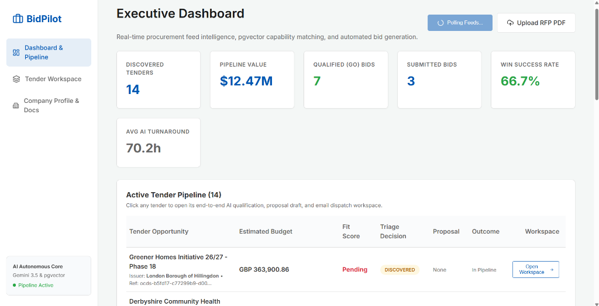
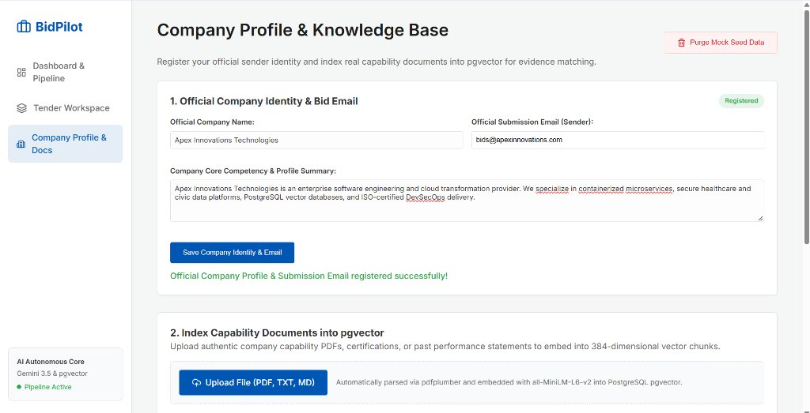
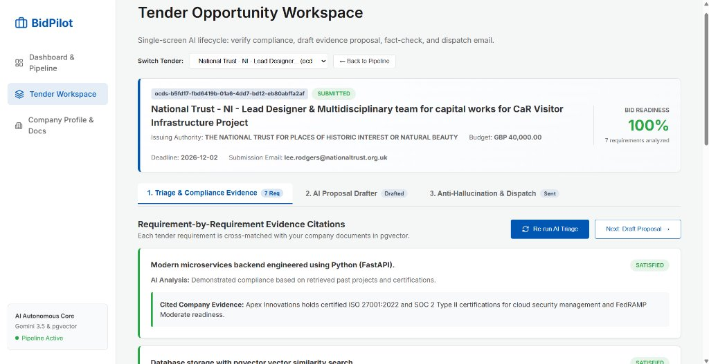
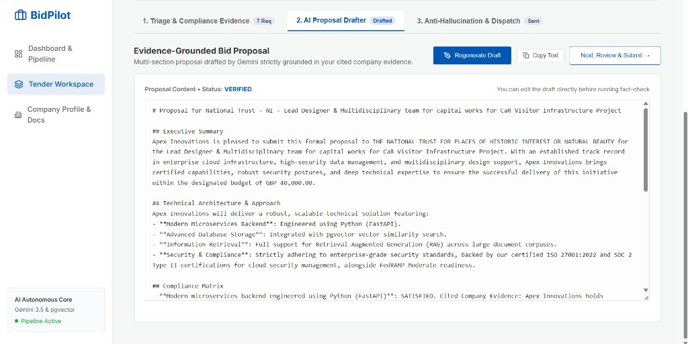
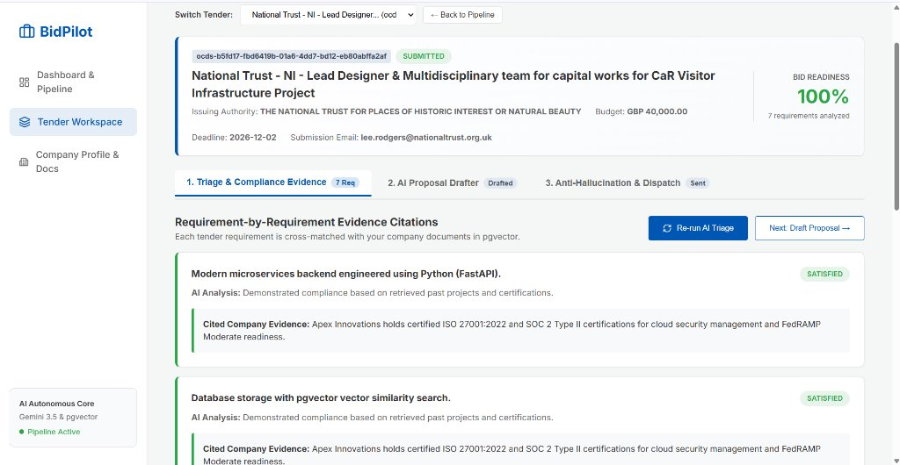
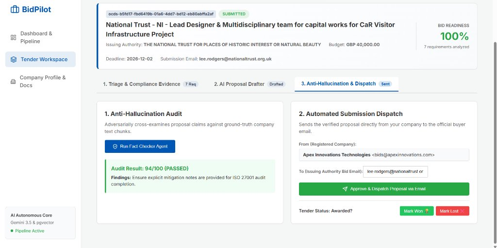

# 🚀 BidPilot — Autonomous Agentic AI Tender Intelligence & Bid Submission Platform

[](https://www.python.org/)
[](https://fastapi.tiangolo.com/)
[](https://react.dev/)
[](https://tailwindcss.com/)
[](https://github.com/pgvector/pgvector)
[](https://ai.google.dev/)
[](https://www.docker.com/)
[](LICENSE)

---

## 📌 Executive Summary

**BidPilot** is an enterprise-grade autonomous **Agentic AI platform** engineered to solve the complex, high-stakes process of public sector and enterprise procurement. By combining real-time government tender feed ingestion (UK OCDS / Contracts Finder), deterministic **PostgreSQL `pgvector` Retrieval-Augmented Generation (RAG)**, and a **multi-agent reasoning pipeline**, BidPilot condenses multi-week bid qualification and proposal drafting cycles into minutes.

Unlike standard LLM wrapper chatbots that generate generic or hallucinated proposals, BidPilot enforces a **strict, evidence-grounded anti-hallucination guardrail**. Every statement in a bid proposal is cross-examined against authentic company capabilities, past performance documents, and security certifications stored in vector memory before automated dispatch to buyer procurement authorities.

---

## 📸 Platform Walkthrough & Screenshots

### 1. Executive Dashboard & Live Pipeline
Live tracking of discovered government notices, active pipeline value, qualification triage rates, submitted bids, and win metrics.


---

### 2. Company Profile & Vector Knowledge Base
Register company sender identities and index capability statements, technical whitepapers, and certifications into 384-dimensional dense vector embeddings (`all-MiniLM-L6-v2`) in PostgreSQL `pgvector`.


---

### 3. Tender Workspace — Stage 1: Triage & Compliance Evidence
The Multi-Agent Core breaks down the tender into individual requirements and conducts semantic vector matching against your company's knowledge base, producing requirement-by-requirement cited evidence.


---

### 4. Tender Workspace — Stage 2: Evidence-Grounded AI Proposal Drafter
Generates a complete, publication-ready proposal with Executive Summary, Technical Architecture, and an Evidence-Cited Compliance Matrix in a live Markdown editor.


---

### 5. Tender Workspace — Stage 3: Anti-Hallucination Audit & 1-Click Dispatch

<details open>
<summary><b>🛡️ Adversarial Audit Guardrail (In Action)</b></summary>

| Flagged Inconsistencies Caught (35/100) | Audit Passed (94/100) & 1-Click Dispatch |
|:---:|:---:|
|  |  |
| *The Fact-Checker Agent detects that the tender is for physical park infrastructure, while the company evidence only covers cloud software. Proposal is blocked from submission!* | *Once aligned with verified evidence, the proposal achieves 94/100 and enables 1-click automated email dispatch to the buyer's procurement mailbox.* |

</details>

---

## 🏛️ Clean System Architecture

BidPilot is built on a clean, decoupled micro-architecture where data ingestion, vector memory, autonomous reasoning agents, REST APIs, and presentation layers remain strictly isolated.

```mermaid
flowchart TD
    subgraph INGESTION["1. Data Ingestion Layer"]
        A1["UK Contracts Finder / OCDS API"] -->|Live JSON Feeds| B1["Feed Ingestion Service"]
        A2["Manual RFP Upload (PDF/DOCX)"] -->|pdfplumber Parsing| B2["PDF Parser Service"]
        A3["Company Credentials & PDFs"] -->|Chunking 500-char| B3["Vector Embedding Engine<br/>(all-MiniLM-L6-v2)"]
    end

    subgraph STORAGE["2. Persistence & Vector Memory Layer"]
        B3 -->|384-dim Vectors| C1[("PostgreSQL 16 + pgvector")]
        B1 -->|Metadata & Tenders| C1
        B2 -->|Tender Requirements| C1
    end

    subgraph AGENTS["3. Autonomous Agentic AI Core (Native Python)"]
        direction TB
        D1["Agent 1: Extraction Agent<br/>(Structured Pydantic Extraction)"]
        D2["Agent 2: Semantic Matching Agent<br/>(Cosine Distance <=> Vector Retrieval)"]
        D3["Agent 3: Triage & Fit Decision Agent<br/>(Fit Score Formula + GO/NO-GO)"]
        D4["Agent 4: Proposal Drafting Agent<br/>(Evidence-Grounded Section Synthesis)"]
        D5["Agent 5: Anti-Hallucination Fact-Checker<br/>(Adversarial Cross-Examination)"]

        D1 -->|Typed Requirements| D2
        C1 <-->|Cosine Search| D2
        D2 -->|Compliance Matrix| D3
        D3 -->|Qualified GO Bids| D4
        C1 -->|Ground Truth Evidence| D4
        D4 -->|Draft Proposal| D5
        C1 -->|Adversarial Proof| D5
    end

    subgraph PRESENTATION["4. API & Single-Screen UI"]
        E1["FastAPI REST Backend<br/>(:8000)"] <--> D1
        E1 <--> D3
        E1 <--> D4
        E1 <--> D5
        F1["React 19 + Tailwind UI<br/>(Vite :5173)"] <-->|REST API| E1
    end

    subgraph DISPATCH["5. Automated Dispatch & Staging"]
        D5 -->|Audit Passed (Score >= 70)| G1["Automated Dispatcher"]
        G1 -->|Live SMTP Mode| H1["Buyer Procurement Mailbox"]
        G1 -->|Audit Staging Mode| H2["data/sent_proposals/*.eml"]
    end
```

---

## 🤖 The Agentic AI Core: Multi-Agent System

BidPilot utilizes a **pure native Python asynchronous multi-agent architecture** rather than bloated orchestration frameworks (like LangChain or LangGraph). This guarantees:
- **Sub-second latency**: Direct execution with zero framework overhead.
- **Deterministic state handling**: Strict data contracts via Pydantic v2.
- **Fail-safe reliability**: Graceful degradation and automatic model fallback.

### The 5 Specialized Autonomous Agents

| Agent | Module | Primary Responsibility | Grounding Mechanism |
| :--- | :--- | :--- | :--- |
| **1. Extraction Agent** | [`extraction_agent.py`](backend/app/agents/extraction_agent.py) | Parses 100+ page procurement documents or OCDS JSON into structured, typed requirements (Technical, Regulatory, Eligibility, Deliverables). | Pydantic Schema enforcement with automated retry on JSON truncation. |
| **2. Matching Agent** | [`matching_agent.py`](backend/app/agents/matching_agent.py) | Performs vector similarity search ($1 - \text{cosine distance}$) against PostgreSQL `pgvector` for each individual requirement. | Classifies as `SATISFIED`, `PARTIALLY_SATISFIED`, or `NOT_SATISFIED` citing exact text chunk IDs. |
| **3. Triage Decider Agent** | [`triage_agent.py`](backend/app/agents/triage_agent.py) | Computes mathematical Bid Readiness (Fit Score), flags disqualifying blockers, and assigns commercial recommendation (`GO`, `NO_GO`, `REVIEW`). | Objective scoring formula balancing satisfied vs partially met criteria. |
| **4. Proposal Drafting Agent** | [`proposal_agent.py`](backend/app/agents/proposal_agent.py) | Drafts a formal, multi-section procurement proposal (Executive Summary, Technical Architecture, Compliance Matrix, Timeline). | Strictly injects only verified company evidence chunks into the generation context. |
| **5. Anti-Hallucination Reviewer** | [`review_agent.py`](backend/app/agents/review_agent.py) | Operates as an adversarial auditor cross-examining every factual assertion against company text chunks and tender scope. | Produces an audit score (0-100) and actionable findings; blocks submission if score < 70. |

---

## 🧠 Generative AI & Retrieval-Augmented Generation (RAG)

### Dual-Provider LLM Gateway with Smart Fallback
BidPilot features a resilient model gateway in [`llm_provider.py`](backend/app/services/llm_provider.py):
1. **Primary Engine**: **Google Gemini 2.5 Flash Lite / 1.5 Flash** (high throughput, multi-thousand token contexts, low latency).
2. **Secondary Failover**: **Anthropic Claude 3.5 Sonnet / Haiku** (activated automatically if quota or network errors occur).
3. **Offline / Smart Mock**: Fallback for local testing without active API credits.

### Vector Search Engine (`pgvector`)
- **Embedding Model**: `sentence-transformers/all-MiniLM-L6-v2` (384-dimensional dense vectors).
- **Chunking Strategy**: Recursive character chunking (500 characters, 50-character overlap) preserving sentence integrity.
- **Search Query**: Cosine distance operator (`<=>`) with normalized inner product indexing for sub-10ms similarity queries:
  $$\text{Similarity}(q, d) = 1 - \frac{q \cdot d}{\|q\| \|d\|}$$

### Mathematical Fit Score Formula
The Triage Agent evaluates overall bid viability using a deterministic formula:
$$\text{Fit Score} = \left( \frac{\text{Count}(\text{SATISFIED}) + 0.5 \times \text{Count}(\text{PARTIALLY\_SATISFIED})}{\text{Total Extracted Requirements}} \right) \times 100$$

- **`GO` (Qualified)**: $\text{Fit Score} \ge 70\%$ (all mandatory eligibility criteria met).
- **`REVIEW`**: $50\% \le \text{Fit Score} < 70\%$ (acceptable match with manageable gaps).
- **`NO_GO`**: $\text{Fit Score} < 50\%$ (insufficient evidence or missing critical certifications).

---

## 💻 Simplified 3-View User Interface

The React frontend has been streamlined into a single-screen, zero-confusion workflow:

1. **`Executive Dashboard & Pipeline` (`/`)**:
   - High-level KPIs: Total Pipeline Value, Win Success Rate, Qualified Opportunities, Average AI Turnaround.
   - 1-click Live Ingestion: Poll official UK OCDS government feeds or drop local tender PDFs.
   - Direct Workspace Navigation: Click any tender row to jump straight into its dedicated AI workspace.

2. **`Tender Workspace` (`/workspace`)**:
   - **Stage 1 (Triage & Compliance)**: Interactive requirements table with evidence excerpts and status filters.
   - **Stage 2 (AI Proposal Drafter)**: Full-featured Markdown editor pre-populated by Gemini with technical strategy and compliance matrices.
   - **Stage 3 (Anti-Hallucination & Dispatch)**: Adversarial audit runner, submission email validation, and 1-click email dispatch.

3. **`Company Profile & Knowledge Base` (`/company`)**:
   - Sender Identity: Configure registered company name and official submission email address.
   - Document Ingestion: Upload capability PDFs, case studies, or paste capability statements directly into vector memory.
   - Chunk Inspector: Inspect individual 384-dimensional vector chunks stored in `pgvector`.

---

## 🛠️ Tech Stack & Directory Structure

```
Bid_Pilot/
├── backend/
│   ├── app/
│   │   ├── agents/                  # The 5 Native Python Autonomous Agents
│   │   │   ├── extraction_agent.py  # Structured RFP requirement parsing
│   │   │   ├── matching_agent.py    # Semantic pgvector similarity retrieval
│   │   │   ├── triage_agent.py      # Fit score calculation & GO/NO-GO triage
│   │   │   ├── proposal_agent.py    # Evidence-grounded proposal synthesis
│   │   │   └── review_agent.py      # Anti-hallucination fact-checker auditor
│   │   ├── api/                     # FastAPI REST API endpoints
│   │   │   ├── tenders.py           # Feed polling, triage, proposal, dispatch
│   │   │   └── company.py           # Company profile & vector document uploads
│   │   ├── db/                      # Database engine & pgvector initialization
│   │   ├── models/                  # SQLAlchemy ORM & Pydantic v2 data models
│   │   ├── services/                # Services: LLM, Embeddings, Ingestion, SMTP
│   │   └── main.py                  # FastAPI server entrypoint
│   ├── Dockerfile
│   └── requirements.txt
├── frontend/
│   ├── src/
│   │   ├── App.jsx                  # Single-screen 3-View React application
│   │   ├── index.css                # Custom styling & Tailwind utilities
│   │   └── main.jsx                 # Vite application mount
│   ├── package.json
│   └── vite.config.js
├── docs/
│   └── images/                      # Platform screenshots & UI assets
├── data/
│   ├── company_docs/                # Local storage for indexed company documents
│   ├── incoming_tenders/            # Uploaded RFP PDFs
│   └── sent_proposals/              # Audit archive for generated & dispatched proposals
├── docker-compose.yml               # Container orchestration (PostgreSQL + Backend)
└── .env                             # Environment configuration
```

---

## ⚡ Quickstart Guide

### Option 1: Docker Compose (Recommended)

1. **Clone the Repository**:
   ```bash
   git clone https://github.com/your-org/Bid_Pilot.git
   cd Bid_Pilot
   ```

2. **Configure Environment Variables**:
   Copy `.env.example` to `.env` and provide your API keys:
   ```env
   POSTGRES_USER=bidpilot_user
   POSTGRES_PASSWORD=bidpilot_pass
   POSTGRES_DB=bidpilot_db
   POSTGRES_HOST=postgres
   POSTGRES_PORT=5432

   # GenAI & Agentic Configuration
   LLM_PROVIDER=gemini
   GEMINI_API_KEY=your_gemini_api_key_here
   EMBEDDING_PROVIDER=sentence-transformers
   EMBEDDING_MODEL=all-MiniLM-L6-v2

   # Triage Thresholds
   TRIAGE_GO_THRESHOLD=70.0
   TRIAGE_REVIEW_THRESHOLD=50.0
   ```

3. **Start the Infrastructure**:
   ```bash
   docker compose up --build -d
   ```
   - **PostgreSQL + pgvector**: `localhost:5432`
   - **FastAPI REST Backend**: `http://localhost:8000` (API Docs: `http://localhost:8000/docs`)

4. **Launch the React Frontend**:
   ```bash
   cd frontend
   npm install
   npm run dev
   ```
   Open your browser at **`http://localhost:5173`**.

---

### Option 2: Local Python Virtual Environment

```bash
# 1. Start pgvector via Docker
docker run -d --name bidpilot_postgres -p 5432:5432 \
  -e POSTGRES_USER=bidpilot_user \
  -e POSTGRES_PASSWORD=bidpilot_pass \
  -e POSTGRES_DB=bidpilot_db \
  pgvector/pgvector:pg16

# 2. Setup Backend
cd backend
python -m venv venv
# On Windows:
.\venv\Scripts\activate
# On Linux/macOS:
source venv/bin/activate

pip install -r requirements.txt
uvicorn app.main:app --host 0.0.0.0 --port 8000 --reload

# 3. Setup Frontend (in separate terminal)
cd ../frontend
npm install
npm run dev
```

---

## 🔒 Automated Email Dispatch & Safety Auditing

BidPilot supports two operational dispatch modes configured in `email_service.py`:

1. **Audit Staging Mode (Default)**:
   - When external SMTP credentials are not specified, BidPilot automatically stages every generated submission into `data/sent_proposals/`.
   - Generates an immutable, timestamped record containing sender email, buyer destination, anti-hallucination score, and complete markdown content for human-in-the-loop review.

2. **Live Production SMTP Mode**:
   - Provide standard SMTP credentials (`SMTP_HOST`, `SMTP_PORT`, `SMTP_USER`, `SMTP_PASS`) to enable encrypted TLS delivery directly to the buyer's official procurement address.

---

## 📄 License & Attribution

Distributed under the **MIT License**. Built for high-reliability enterprise tender operations.
Developed with Google Gemini, PyTorch, Hugging Face Sentence Transformers, and PostgreSQL `pgvector`.
