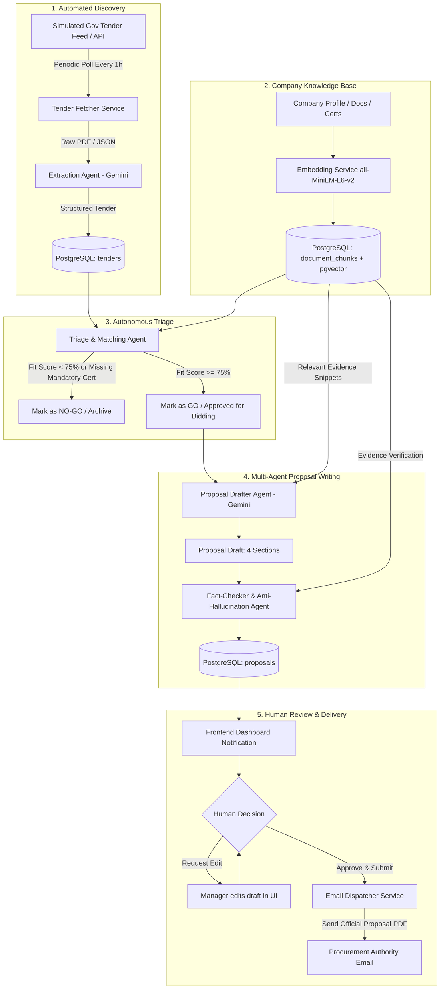

# BidPilot: Autonomous GenAI Platform Implementation Plan

## 1. Executive Summary & Vision

**BidPilot** is transforming from a prototype with manual file uploads into a **fully autonomous, agentic GenAI platform** for enterprise tender intelligence. 

In this target architecture:
1. **Automated Discovery:** The platform continuously polls simulated or public procurement feeds/APIs, automatically ingesting and parsing new tenders without human intervention.
2. **Knowledge Base:** The company sets up its credentials, past performance, employee skills, and certifications once into a persistent vector database (**PostgreSQL + pgvector**).
3. **Autonomous "Go / No-Go" Filter:** An AI Triage Agent evaluates each new tender against company specs. If fit score ≥ 75%, it automatically advances the tender; if unqualified, it marks it as "No-Go" with clear rationale.
4. **Multi-Agent Evidence-Grounded Proposal Generation:** A specialized GenAI pipeline (Drafter Agent + Anti-Hallucination Fact-Checker Agent) writes a comprehensive, professional bid proposal strictly grounded in verified company evidence.
5. **Human-in-the-Loop Approval & Email Dispatch:** A manager reviews the proposal and clicks **"Approve & Submit"**, which automatically emails the completed proposal and compliance matrix to the issuing authority.

---

## 2. Current Implementation vs. Required Capabilities

| Component | Current State | Target State | Status / Gap |
| :--- | :--- | :--- | :--- |
| **Container & DB** | Dockerized PostgreSQL 16 with `pgvector` active on port 5432. | Retained + dynamic proposal & tender schema. | 🟢 Completed |
| **LLM Provider** | Multi-model failover (`gemini-3.8-flash` -> `gemini-3.5-flash-lite` -> `MockLLMProvider`). | Resilient GenAI pipeline with structured JSON extraction. | 🟢 Completed |
| **Tender Ingestion** | Live UK Gov Contracts Finder OCDS API polling + text requirement extraction. | Dynamic background feed ingestion (`/api/tenders/fetch_new`). | 🟢 Completed |
| **Company Knowledge Base** | Vector indexing in `document_chunks` with `all-MiniLM-L6-v2` & company profile management. | Live upload endpoint (`/api/company/documents`) to chunk, embed, and index evidence. | 🟢 Completed |
| **Triage "Go/No-Go" Agent** | Autonomous `TriageAgent` computing dynamic Fit Score & GenAI strategic compliance analysis. | Dynamic configurable thresholds from `.env` and company profile. | 🟢 Completed |
| **Proposal Generator Agent** | Backend `ProposalAgent` generating 4-part evidence-backed proposal via Gemini. | Verified live proposal generation with vector evidence retrieval. | 🟢 Completed |
| **Anti-Hallucination Review** | Backend `ReviewAgent` auditing claims against retrieved vector evidence. | GenAI claim audit catching unverified claims. | 🟢 Completed |
| **Automated Email Dispatch** | Backend `EmailService` with dynamic sender (from company profile) and dynamic recipient (from tender notice). | Live SMTP dispatch + EML audit logging. | 🟢 Completed |
| **Dynamic Dashboard Metrics** | Real-time SQL & timestamp calculations: dynamic pipeline value, win rate, and turnaround time. | 100% dynamic DB metrics with zero hardcoded numbers. | 🟢 Completed |
| **Frontend UI Integration** | Live Axios React dashboard with dynamic metric cards, status updating, and email dispatch modal. | Fully responsive, live interactive UI. | 🟢 Completed |

---

## 3. Architecture & Data Flow

---

## 4. Phase-by-Phase Implementation Roadmap

### Phase 1: Database Schema Expansion
Add the missing entities required for proposal persistence, status tracking, and automated feeds.
- **`proposals` table:**
  - `id`: Primary key
  - `tender_id`: Foreign key to `tenders.id`
  - `executive_summary`: Text
  - `technical_approach`: Text
  - `compliance_matrix`: JSONB (Requirement, Status, Evidence Citation)
  - `commercial_terms`: Text
  - `full_content`: Text (Complete Markdown)
  - `status`: `DRAFT` | `VERIFIED` | `APPROVED` | `SUBMITTED`
  - `review_notes`: Text
  - `created_at`, `updated_at`: Timestamp
- **Tender Status Updates:**
  - Update `tenders` table with `status`: `DISCOVERED` | `EVALUATED` | `PROPOSAL_READY` | `SUBMITTED` | `NO_GO`
  - Add `fit_score`: Float (0 to 100)
  - Add `issuer_email`: String (Recipient for submission)

---

### Phase 2: Autonomous Tender Discovery & Ingestion Pipeline
Eliminate manual PDF uploads by creating an autonomous fetcher:
1. **`backend/app/services/tender_fetcher.py`**:
   - Implements a simulated government procurement feed / API endpoint.
   - Watches `data/incoming_tenders/` directory using Python `watchdog` or polling.
   - Provides scheduled polling using `APScheduler` or FastAPI background tasks.
2. **Automatic Pipeline Trigger**:
   - When a new tender is detected, it immediately triggers `ExtractionAgent` (using Gemini).
   - Saves parsed metadata into the database and triggers the Triage Agent.

---

### Phase 3: Live Company Knowledge Base Endpoints
Allow the company to manage its evidence repository dynamically:
1. **API Endpoints (`backend/app/api/company.py`)**:
   - `POST /api/company/profile`: Update company core profile.
   - `POST /api/company/documents/upload`: Upload capability statements, certificates (PDF/TXT).
   - Automatically chunks text (500 chars with 50 char overlap) and creates 384-dimensional vector embeddings using `all-MiniLM-L6-v2`.
   - `GET /api/company/documents`: List all indexed evidence documents and chunk stats.

---

### Phase 4: Autonomous "Go / No-Go" Triage & Matching Agent
1. **`backend/app/agents/triage_agent.py`**:
   - Performs semantic vector search on every requirement of newly fetched tenders.
   - Detects **Hard Blockers** (e.g. missing mandatory ISO 27001 or missing required annual turnover).
   - Calculates **Fit Score**:
     $$\text{Fit Score} = \frac{\text{Satisfied Requirements} + 0.5 \times \text{Partially Satisfied}}{\text{Total Requirements}} \times 100$$
   - Sets status:
     - `fit_score >= 75%`: **`GO`** (Proceeds directly to proposal generation).
     - `60% <= fit_score < 75%`: **`REVIEW`** (Requires human review before proposal drafting).
     - `fit_score < 60%` or Hard Blocker: **`NO_GO`** (Archived with explanation).

---

### Phase 5: Multi-Agent Proposal Writing & Anti-Hallucination Pipeline
1. **Proposal Drafter Agent (`backend/app/agents/proposal_agent.py`)**:
   - Uses **Gemini 1.5 Flash / Pro** with structured section prompts.
   - Pulls top evidence chunks from `document_chunks` for every matched requirement.
   - Generates four professional sections:
     1. Executive Summary & Understanding of RFP Objectives
     2. Technical Solution, Architecture & Milestones
     3. Compliance & Traceability Matrix
     4. Past Performance & Experience
2. **Review & Anti-Hallucination Agent (`backend/app/agents/review_agent.py`)**:
   - Cross-examines each statement in the draft against the retrieved company documents.
   - Flags unsupported claims with `UNSUPPORTED_CLAIM_WARNING`.
   - If clean, marks proposal status as **`VERIFIED`**.

---

### Phase 6: Human Approval Gate & Automated Email Dispatch
1. **Email Dispatch Service (`backend/app/services/email_service.py`)**:
   - Integrates Python `smtplib` (support for Gmail/Outlook/SendGrid SMTP via `.env`).
   - Generates a PDF attachment of the approved proposal.
   - Sends formatted email to the tender authority (`issuer_email`) with CC to company executives.
2. **Endpoint:**
   - `POST /api/proposals/{proposal_id}/approve_and_send`
   - Updates status to `SUBMITTED`, records timestamp, and sends email.

---

### Phase 7: Frontend Full-Stack Integration
Upgrade [frontend/src/App.jsx](file:///c:/Users/Lekshmi%20Priya/OneDrive/Documents/GitHub/Bid_Pilot/frontend/src/App.jsx) from simulated `setTimeout` mocks to live Axios endpoints:
1. **Dashboard:** Live KPI numbers queried from `GET /api/dashboard/metrics`.
2. **Tender Feed View:** Live list of auto-discovered tenders with "GO / NO-GO" filter badges.
3. **Company Documents:** Real file drag-and-drop to upload and index evidence into `pgvector`.
4. **Proposal View:** Rich markdown editor loaded with real Gemini-generated draft.
5. **Approve & Send Button:** Real-time trigger of email dispatch with delivery receipt toast.

---

## 5. Implementation Priority Matrix

| Phase | Milestone | Est. Time | Complexity |
| :--- | :--- | :--- | :--- |
| **Phase 1** | Schema Expansion (`proposals` table & status fields) | 1 hour | Low |
| **Phase 2** | Real Gemini Proposal Drafter & Review Agent | 2 hours | Medium |
| **Phase 3** | Automated Tender Fetcher & Ingestion Service | 1.5 hours | Medium |
| **Phase 4** | Autonomous Triage Agent & "Go/No-Go" Scoring | 1.5 hours | Medium |
| **Phase 5** | Email Dispatcher Service (`smtplib`/SendGrid) | 1 hour | Low |
| **Phase 6** | Frontend Live Axios Integration | 2 hours | Medium |

---

## 6. Success Metrics for the Project
- **Zero Hallucination:** 100% of claims in the generated proposal are backed by citations to indexed company documents.
- **Hands-Free Ingestion:** New tenders appear in the dashboard automatically within 30 seconds of publication.
- **Autonomous Gating:** Unfit tenders are filtered out without wasting human analysis time.
- **Single-Click Dispatch:** Proposal moves from verified draft to submitted email with one click.
